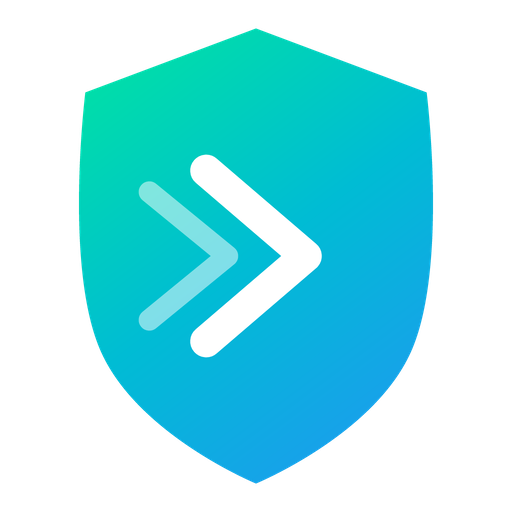
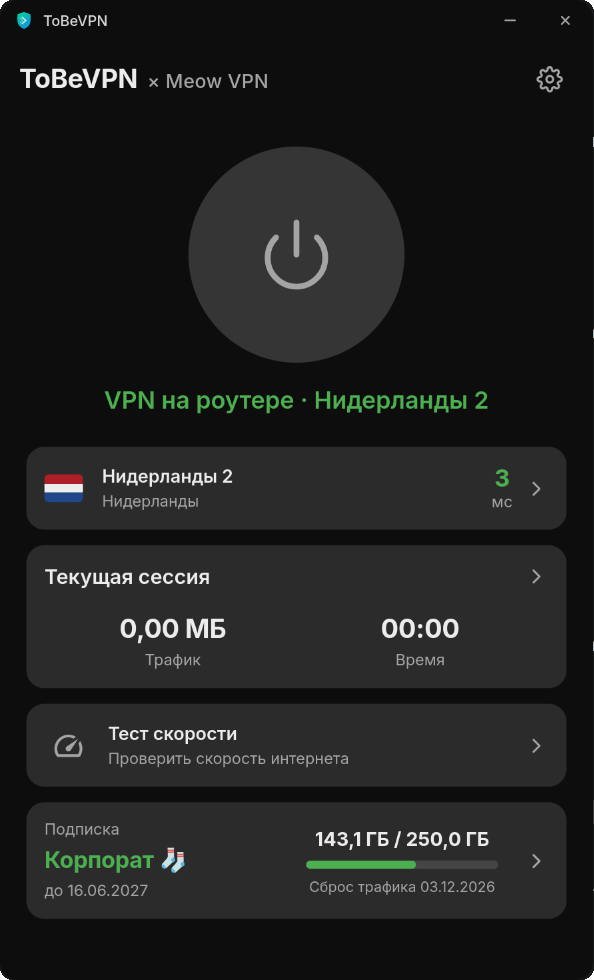
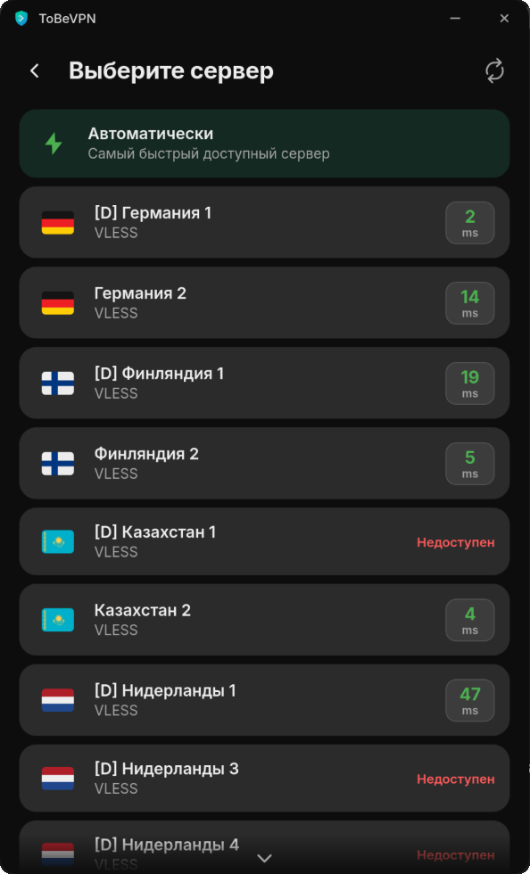
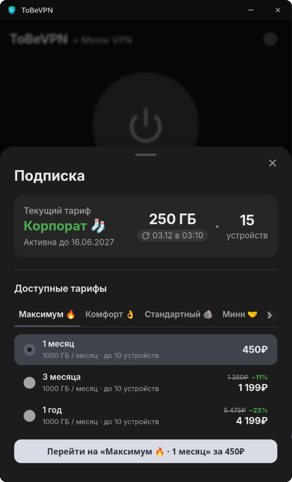
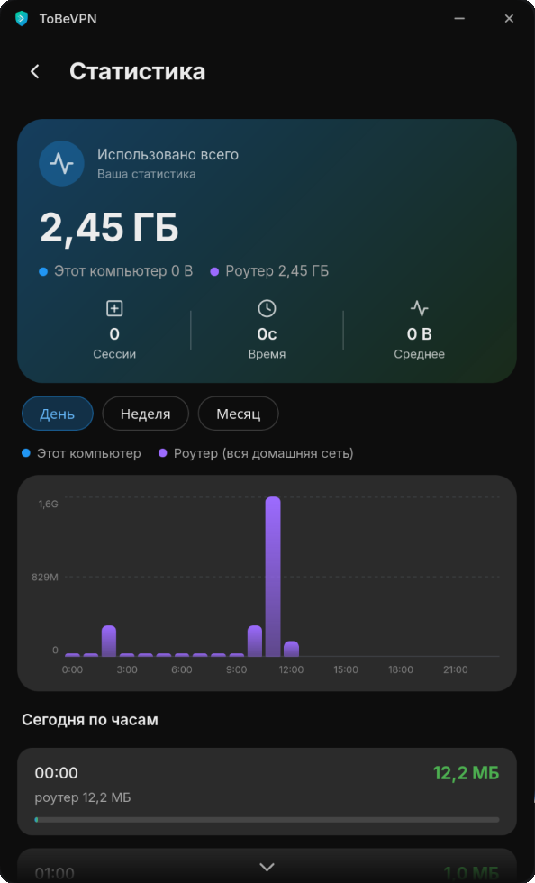
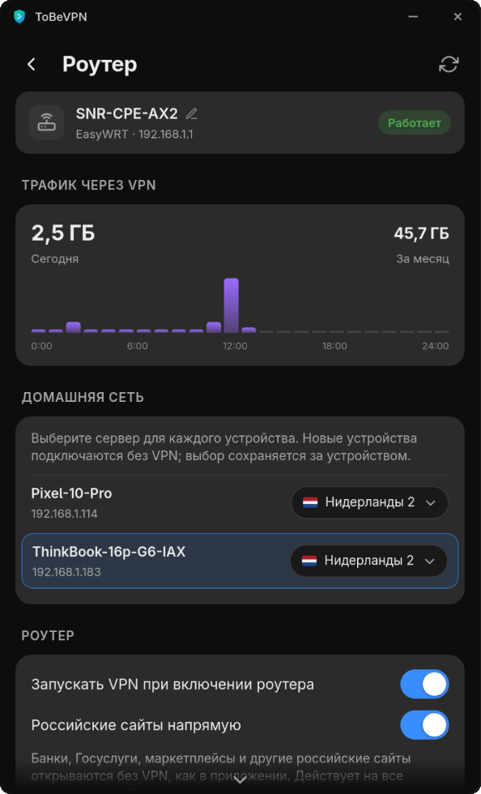
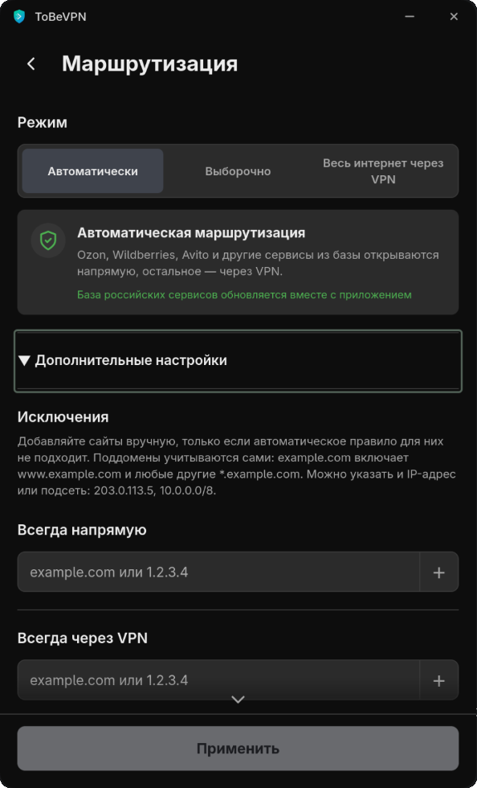
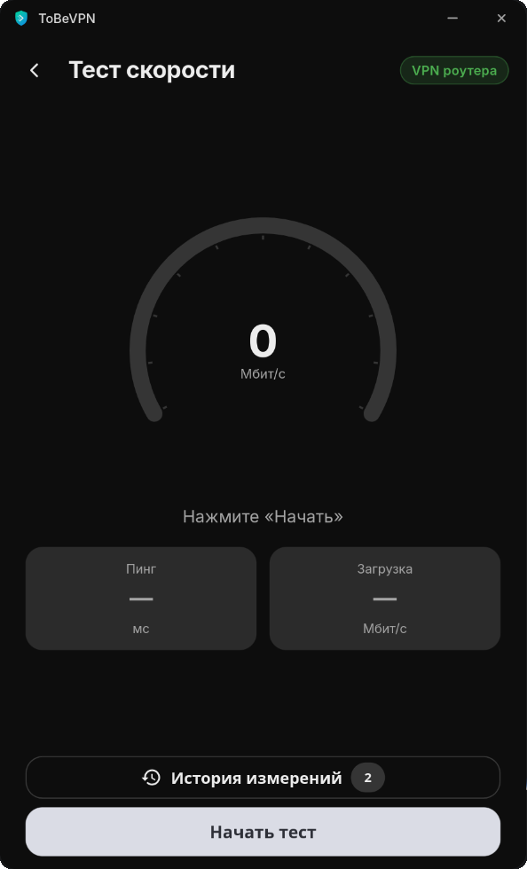
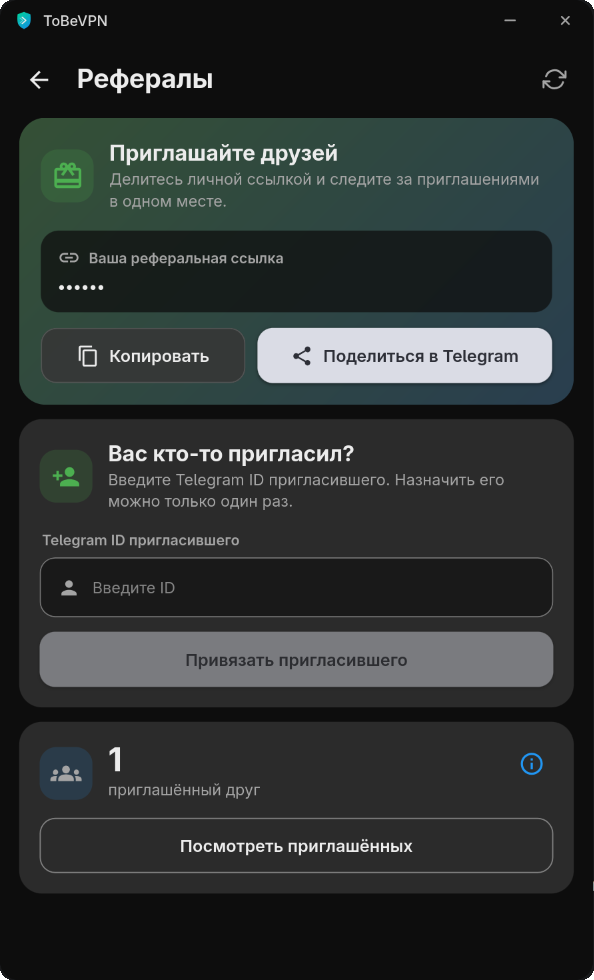
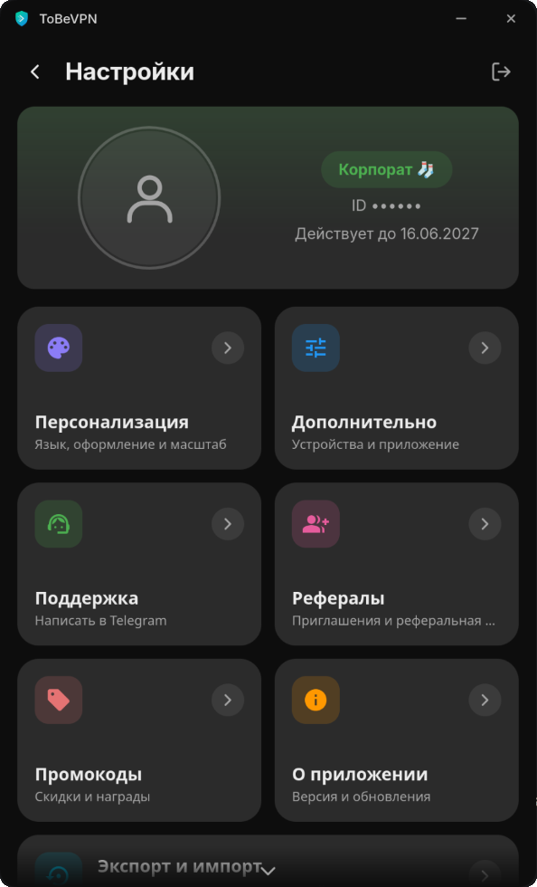

# ToBeVPN

**Современный VPN-клиент для Linux и Windows с подпиской, выбором серверов и встроенными обновлениями.**

---

## Что это

ToBeVPN — нативный desktop-клиент к VPN-сети с защищённым подключением, управлением подпиской и привязкой устройств. Авторизация через Telegram, серверы с пингом и автовыбором, правила маршрутизации по доменам и IP, VPN на домашнем роутере, статистика трафика и встроенные обновления.

## Главное

| | |
|--|--|
| 🛡️ **Защищённое подключение** | VLESS + REALITY и Hysteria2, системный VPN через TUN |
| 🖥️ **Linux / Windows** | `.deb` (в т.ч. сборка для Astra 1.7), пакет для Arch, установщик для Windows |
| 🌍 **Выбор сервера** | Список серверов с пингом и статусом, автоматический выбор лучшего |
| 🧭 **Маршрутизация** | «Всегда напрямую» и «Всегда через VPN» для доменов, IP-адресов и подсетей |
| 🏠 **VPN на роутере** | Подключение роутера с OpenWrt, свой сервер для каждого устройства; определение Keenetic |
| ⏸️ **Пауза в сети роутера** | В сети роутера с VPN — VPN компьютера на паузе, вне её — включается сам |
| 📈 **Статистика** | Сессии, длительность и трафик по дням и часам |
| 🚦 **Тест скорости** | Замер скорости и история замеров |
| 🔐 **Вход через Telegram** | Без пароля, привязка устройства по QR или коду |
| 💳 **Подписка** | Тариф, лимиты, устройства, промокоды и реферальная программа |
| 🔁 **Перенос настроек** | Экспорт и импорт настроек с выбором, что сохранить |
| 🔄 **Встроенные обновления** | Проверка и установка с проверкой подписи; «Что нового» после обновления |
| 🔑 **Права на Linux** | После установки VPN и обновления работают без повторных запросов пароля |
| 🌗 **Внешний вид** | Светлая и тёмная темы, RU / EN, автозапуск |
| 🛟 **Резервный маршрут** | При недоступности основного бэкенда — автоматический повтор через резервный |

## Скриншоты

  <table>
    <tr>
      <td align="center"><b>Главный экран</b></td>
      <td align="center"><b>Серверы</b></td>
      <td align="center"><b>Подписка</b></td>
    </tr>
    <tr>
      <td></td>
      <td></td>
      <td></td>
    </tr>
    <tr>
      <td align="center"><b>Статистика</b></td>
      <td align="center"><b>Роутер</b></td>
      <td align="center"><b>Маршрутизация</b></td>
    </tr>
    <tr>
      <td></td>
      <td></td>
      <td></td>
    </tr>
    <tr>
      <td align="center"><b>Тест скорости</b></td>
      <td align="center"><b>Рефералы</b></td>
      <td align="center"><b>Настройки</b></td>
    </tr>
    <tr>
      <td></td>
      <td></td>
      <td></td>
    </tr>
  </table>

## Безопасность

- Backend-хосты не хранятся в исходниках — подставляются при сборке.
- Сетевые запросы ограничены конкретным списком разрешённых хостов.
- Auth/session токены хранятся в системном keyring.
- Обновления проверяются по цифровой подписи.
- Системный VPN на Linux работает через ограниченные polkit-helpers без постоянных запросов пароля.

## Связанные репозитории

- **Android-клиент:** [ToBeVPN-Android](https://github.com/Shoolife/ToBeVPN-Android) — нативный Android-клиент
- **Android TV-клиент:** [ToBeVPN-TV](https://github.com/Shoolife/ToBeVPN-TV) — Android TV / приставки

## Roadmap

- [ ] macOS release target
- [ ] Установка VPN на роутеры Keenetic

## Contributing

Issue welcome. PR — лучше предварительно обсудить через issue. Коммиты — present tense, conventional commits не обязательны но приветствуются.

## Лицензия

Проприетарное приложение. Исходный код предоставляется для прозрачности и self-host'инга — коммерческое использование/перепродажа запрещены.

---

  Сделано с ❤️ командой <b>ToBeVPN × Meow VPN</b>

